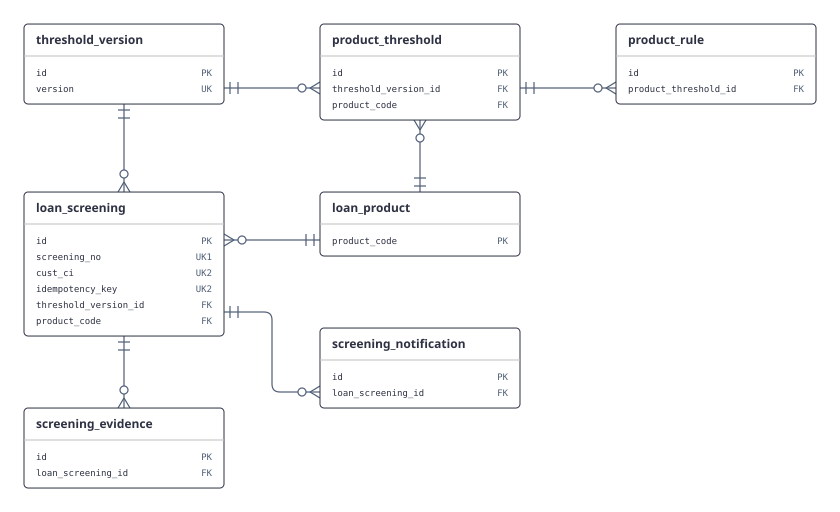

# loan-maru
> 대출 신청을 받아 상품별 규칙으로 한도와 금리를 심사하고, 판정 근거를 남기는 대출 한도 심사 서버

### Project Spec

`Java 21` `Spring Boot 4.x` `PostgreSQL`

### 선택 이유

- **Java 21**: 외부 호환성 제약이 없는 새 프로젝트이고, 현재 LTS 버전이다.
- **Spring Boot 4.x**: 3.x를 유지해야 할 기존 시스템이 없다. 나중에 4.x로 옮기는 비용을 미리 없앤다.
- **PostgreSQL**: 심사 정합성을 DB 기능으로 지키기 쉽다.
  - 규칙별 판정 근거(대외계 기준 시각 등)를 `jsonb`로 저장하고 조회할 수 있다.
  - 부분 유일 인덱스(`WHERE` 조건이 붙은 `UNIQUE`)로 진행 중인 신청만 골라 재신청을 식별할 수 있다.
  - advisory lock으로 같은 차주(`cust_ci`)의 심사 확정을 직렬화해, 동시에 들어온 신청이 한도를 이중으로 쓰지 않게 한다.

### 패키지 구조

```text
me.ngyu.loanmaru
├── application
│   ├── screening        # 대출 심사 신청·판정·결과 조회
│   ├── product          # 대출 상품과 상품별 기준값
│   ├── policy           # 기준값 버전과 심사 규칙
│   └── notification     # 심사 결과 알림
│       (각 도메인 아래 api, domain, service)
├── infrastructure
│   ├── persistence      # Spring Data Repository
│   └── client           # 계정계·대외계 등 외부 서버 Client
└── common
    ├── config
    └── exception
```

패키지는 코드가 생길 때 만든다. 지금은 `common.exception`만 있다.

### ERD


[자세한 ERD 보러가기 →](docs/erd/detailed.md)

### 로컬 실행

Docker와 JDK가 필요하다. 로컬에 JDK 21이 없으면 Gradle이 툴체인을 내려받는다.

```bash
docker compose up -d   # PostgreSQL(localhost:5432/loan_maru)
./gradlew bootRun
```

DB 접속 정보는 `DB_URL`, `DB_USERNAME`, `DB_PASSWORD` 환경변수로 바꿀 수 있다. 기본값은 `compose.yaml`과 같다.
5432 포트를 이미 쓰고 있다면 `DB_PORT=55432 docker compose up -d`로 띄우고 `DB_URL=jdbc:postgresql://localhost:55432/loan_maru`로 실행한다.

테스트는 H2 인메모리 DB(PostgreSQL 모드)로 실행한다.

```bash
./gradlew test
```
