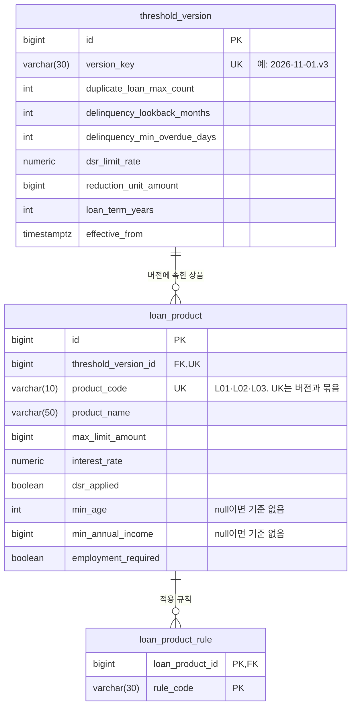

# ERD

`loan-screening-server`의 테이블 구조다. Entity나 테이블을 바꾸면 이 문서도 함께 고친다.

## threshold_version

기준값 버전 하나와 모든 상품에 공통인 심사 기준값(`ScreeningThresholds`), 적용 시작 시각을 저장한다.

- `version_key`는 유일하다.
- 현재 버전은 `effective_from <= 지금`인 행 중 `effective_from`이 가장 늦은 행이다.
- 기준값을 바꿀 때는 행을 고치지 않고 새 버전 행을 만든다.

## loan_product

버전에 속한 상품의 한도, 금리, DSR 적용 여부, 신청 자격(`Eligibility`)을 저장한다.

- 같은 상품 코드라도 버전마다 값이 다를 수 있다. 그래서 `(threshold_version_id, product_code)`에 유일 제약을 둔다.
- `min_age`, `min_annual_income`은 기준이 없으면 null이다.

## loan_product_rule

상품마다 적용할 심사 규칙을 한 행에 하나씩 저장한다.

- PK는 `(loan_product_id, rule_code)`라서 같은 규칙이 두 번 들어가지 않는다.
- `rule_code`: `ELIGIBILITY`, `DUPLICATE_LOAN`, `DELINQUENCY`, `PRODUCT_MAX_LIMIT`, `DSR`
- 규칙을 버전별 상품에 묶어 두므로 나중에 규칙을 추가해도 기존 버전의 구성은 바뀌지 않는다.

## 공통

- 열거형(`product_code`, `rule_code`)은 `VARCHAR`로 저장하고 Hibernate가 CHECK 제약을 만든다.
- 금액은 원 단위 `BIGINT`, 비율은 `NUMERIC(5,2)`, 시각은 `TIMESTAMPTZ`다.
- 초기 데이터는 `src/main/resources/data.sql`이 넣는다. 서버를 재시작해도 유일 제약에 걸린 행은 `ON CONFLICT DO NOTHING`으로 건너뛴다.
