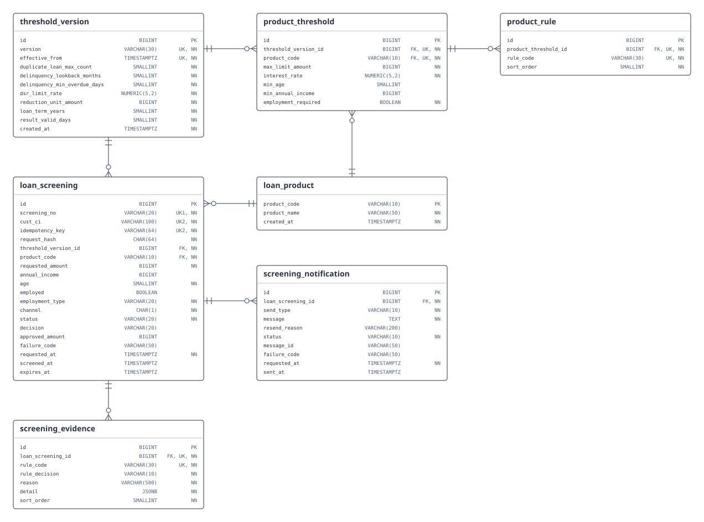

[ERD 크게 보기](detailed.svg) · [요약 ERD](overview.svg)

### loan_product

상품 코드(L01~L03)와 상품명만 두는 상품 원장이다. 한도·금리·자격처럼 바뀌는 값은 버전별 기준값에 두고, 상품은 기준값과 심사가 같은 코드를 가리키도록 참조 대상이 된다.

### threshold_version

기준값 묶음 하나와 그 버전(예: `2026-11-01.v3`), 적용 시작 시각을 저장한다. 상품과 무관한 규칙 기준값(중복 건수, 연체 기간·일수, DSR 비율, 절사 단위, 만기 가정, 결과 유효 일수)도 버전과 1:1이라 같은 행에 둔다. 심사는 시작할 때 이 행을 참조해 기준값을 고정한다.

### product_threshold

버전별·상품별 기준값(최대 한도, 금리, 자격 조건)이다. 버전과 상품 양쪽에 속해야 "어느 시점의 어떤 상품 값인지"가 정해지므로 두 FK에 묶음 유일 제약을 둔다.

### product_rule

버전별 상품 기준값마다 적용할 규칙과 판정 순서를 저장한다. 규칙 조합도 기준값과 함께 버전에 묶어야 심사 당시의 규칙 구성이 보존된다. DSR 적용 여부는 이 목록에 `DSR`이 있는지로 알 수 있어 따로 저장하지 않는다.

### loan_screening

심사 1건의 신청 내용 스냅샷, 재신청 식별 키, 진행 상태, 최종 판정을 저장한다. 기준값 버전과 상품을 참조해 결과 조회와 재발송이 심사 당시 기준으로 표시되게 한다.

### screening_evidence

심사 1건의 규칙별 판정(PASS/ADJUST/FAIL), 사유, 계산 근거를 저장한다. 외부 원장에서 받은 값 중 판정에 쓴 값만 `detail`(jsonb)에 남기므로 심사에 종속된다.

### screening_notification

알림톡 발송 1회를 한 행으로 기록한다(최초 발송과 재발송). 재발송은 최초 행의 본문을 그대로 복사하므로, 각 행이 실제로 보낸 본문과 발송 결과를 그대로 보존한다.

## 설계 결정

### 1. 승인 건을 "이미 실행된 대출"로 간주하는 방법

**별도 점유 테이블을 두지 않고 `loan_screening`을 집계한다.** 같은 `cust_ci`의 `decision IN ('APPROVED','APPROVED_REDUCED')`이고 `expires_at > now()`인 건을 보유 대출로 센다.

- 중복 대출: 같은 `product_code`인 위 건수를 계정계 정상(01) 계좌 수에 더한다.
- DSR: 위 건의 연간 원리금을 자사 원리금에 더한다. 금리는 해당 심사의 버전·상품 `product_threshold.interest_rate`, 만기는 같은 버전의 `loan_term_years`를 쓴다.
- 이유: 점유 정보는 승인 결과와 생명주기(생성·만료)가 같다. 따로 두면 두 테이블을 함께 갱신해야 하고 어긋날 위험만 생긴다. 집계는 부분 인덱스로 빠르게 할 수 있다.
- 한계: 실제로 실행된 승인 건은 계정계 계좌와 승인 건으로 두 번 집계된다. 보수적인 방향(DSR 초과 대출이 실행되지 않는 방향)이라 1차에서는 허용한다. 실행 사실을 알게 되면 점유 해제가 필요하다(열린 질문 1).

### 2. 재신청 식별 키와 유일 제약 범위

**`Idempotency-Key` 헤더가 기준이고, 신청 내용 해시는 충돌 검출용이다.**

- 유일 제약: `UNIQUE (cust_ci, idempotency_key) WHERE status IN ('PROCESSING','FINALIZED')` (부분 유일 인덱스, 도면의 UK2).
- 같은 키 + 같은 `request_hash`: 새 심사를 만들지 않고 기존 결과를 반환한다.
- 같은 키 + 다른 `request_hash`: 409 `IDEMPOTENCY_KEY_CONFLICT`.
- 다른 키: 내용이 같아도 새 신청이다(감액 후 금액을 바꾼 재신청, 만료 후 같은 금액 재신청 모두 새 키).
- `request_hash`는 `productCode`, `requestedAmount`, `applicant`, `channel`을 정규화한 JSON의 SHA-256(hex 64자)이다.
- 범위를 차주 단위로 둔 이유: 키는 클라이언트가 만든 값이라 다른 차주의 키와 겹쳐도 서로 영향을 주지 않아야 한다.
- `FAILED`를 제약에서 뺀 이유: 외부 장애로 실패한 신청을 같은 키로 다시 보내면 새로 심사할 수 있어야 한다. 실패 행은 이력으로 남는다.

### 3. 기준값 저장 방식

**버전 테이블 + 타입이 있는 컬럼(`threshold_version`, `product_threshold`, `product_rule`)으로 저장한다.** key-value는 쓰지 않는다.

- 이유: 금액·비율·일수마다 타입과 CHECK 제약을 걸 수 있고, JPA Entity로 바로 옮겨진다. 한 버전의 값 전체를 한 번에 읽어 심사에 고정하기 쉽다.
- 대가: 새 규칙 기준값이 생기면 컬럼 추가 마이그레이션이 필요하다. 규칙 추가는 어차피 판정 코드 배포가 필요하므로 받아들인다.
- 버전 행은 만든 뒤 고치지 않는다. 변경은 새 버전을 만들고 `effective_from`을 지정한다. 현재 버전은 `effective_from <= now()` 중 가장 늦은 행이다.
- 심사는 시작할 때 `threshold_version_id`를 저장하고, 이후 판정·조회·재발송은 모두 이 버전으로 한다. 인스턴스마다 캐시 반영 시점이 달라도 각 심사는 자기가 고정한 버전으로 끝까지 일관된다.
- 1차 오픈은 마이그레이션 시드로 버전 1개(L01~L03, 규칙 구성 포함)를 넣는다. 운영자 변경 화면(MVP 2)은 새 버전 행을 만드는 기능이 된다. 변경자 기록이 필요하면 그때 `created_by`를 추가한다.
- 기획서 기준값의 "1건 보유 시 거절"은 `duplicate_loan_max_count = 1`이고 "보유 건수 >= 기준이면 거절"로 판정한다.

### 4. 외부 데이터 비저장 원칙

계정계 계좌, 여신사후관리 연체 이력, 대외계 타사 대출은 테이블로 저장하지 않는다. 판정에 쓴 값만 `screening_evidence.detail`에 남긴다.

- DUPLICATE_LOAN: `normalAccountCount`, `pendingApprovalCount`, `maxCount`
- DELINQUENCY: `lookbackMonths`, `minOverdueDays`, `maxOverdueDays`
- DSR: API 문서의 계산 필드에 더해 대외계 `baseDateTime`과 `pendingApprovalAnnualRepayment`
- 계좌번호 같은 원장 식별자는 남기지 않는다. 결과 설명과 감사에 필요한 집계값만 둔다.
- 이유: 외부 원장의 사본은 금방 낡고 개인 신용정보 보관 범위만 넓힌다. 심사 결과를 다시 설명하는 데는 판정 시점의 집계값이면 충분하다.

### 5. 동시성

| 상황 | 막는 방법 | 걸리는 곳 |
| --- | --- | --- |
| 같은 신청의 반복 요청(같은 인스턴스, 여러 인스턴스) | 부분 유일 인덱스 UK2에 먼저 `PROCESSING` 행을 넣는다. 뒤 요청은 유일 위반을 받고 기존 행을 읽는다. | `loan_screening` |
| 같은 차주의 서로 다른 심사가 동시에 확정 | 확정 트랜잭션에서 `pg_advisory_xact_lock(hashtext(cust_ci))`를 잡고 승인 대기 건을 다시 읽어 중복 대출·DSR을 계산한 뒤 확정한다. | `loan_screening` 집계 |
| 심사 번호 중복 | DB 시퀀스로 번호를 만들고 UK1로 한 번 더 막는다. | `loan_screening.screening_no` |
| 최초 알림 중복 발송 | `UNIQUE (loan_screening_id) WHERE send_type = 'INITIAL'` | `screening_notification` |

- 외부 조회(최대 수 초)는 잠금 밖에서 한다. 잠금은 DB만 읽는 짧은 확정 구간에만 건다. 외부 값은 어차피 직전 정각 기준이라 잠금 안에서 다시 조회해도 정확도가 늘지 않는다.
- advisory lock은 DB 하나를 공유하는 다중 인스턴스에서 그대로 동작하고, 차주 잠금용 테이블을 따로 두지 않아도 된다.
- 기준값 테이블은 읽기 전용이라 잠금이 없다.

## 열거형과 인덱스

- `loan_screening.status`: `PROCESSING`, `FINALIZED`, `FAILED`. 1차는 동기 처리라 접수 전용 상태(RECEIVED)를 두지 않는다. 행은 심사 시작과 함께 `PROCESSING`으로 생긴다.
- `loan_screening.decision`: `APPROVED`, `APPROVED_REDUCED`, `REJECTED`. `FINALIZED`일 때만 값이 있다. 거절이면 `approved_amount = 0`.
- `employment_type`: `EARNED`(기본). `channel`: `A`(앱, 기본), `W`(웹), `P`(제휴).
- `rule_code`: `ELIGIBILITY`, `DUPLICATE_LOAN`, `DELINQUENCY`, `PRODUCT_MAX_LIMIT`, `DSR`. `rule_decision`: `PASS`, `ADJUST`, `FAIL`.
- `send_type`: `INITIAL`, `RESEND`. 알림 `status`: `REQUESTED`, `SENT`, `FAILED`.
- 열거형은 PostgreSQL enum 타입 대신 `VARCHAR` + CHECK로 둔다. JPA `@Enumerated(STRING)`과 맞고 값 추가가 쉽다.
- 인덱스
  - `loan_screening (cust_ci, screened_at DESC, id DESC)`: 심사 내역 목록 커서 페이징
  - `loan_screening (cust_ci, product_code, expires_at) WHERE decision IN ('APPROVED','APPROVED_REDUCED')`: 승인 대기 건 집계
  - `screening_notification (loan_screening_id, id)`: 최근 발송과 재발송 횟수 조회
  - `screening_notification (requested_at) WHERE status = 'FAILED'`: 재시도 대상 조회
- 금액은 원 단위 `BIGINT`, 비율은 `NUMERIC(5,2)`, 시각은 `TIMESTAMPTZ`다.

## 열린 질문

1. 승인 건의 점유 해제: 대출 실행 사실(계좌번호 등)을 받을 방법이 없어 실행 후에도 만료일까지 이중 집계된다. 실행 이벤트를 받을지, 그대로 둘지 정해야 한다.
2. 결과 유효 기간: 응답 예시(11-19 확정, 12-19 23:59:59 만료)를 보고 "확정일 + 30일의 23:59:59(KST)"로 가정했다(`result_valid_days = 30`). 맞는지 확인이 필요하다.
3. 같은 키 요청이 아직 `PROCESSING`일 때 응답: 409(처리 중) 반환과 완료까지 대기 중 하나를 골라야 한다.
4. `Idempotency-Key` 보관 기간: 1차는 만료 없이 영구 보관으로 두었다. 만료가 필요하면 기간을 정해야 한다.
5. 심사 번호 `LS-yyyyMMdd-NNNNNN`의 NNNNNN을 날마다 1부터 다시 셀지, 전체 시퀀스를 쓸지 정해야 한다.
6. 신용정보 조회 동의: 동의하지 않으면 400이라 저장하지 않았다. 동의 시각을 증적으로 남겨야 하는지 확인이 필요하다.
7. 발송 실패의 자동 재시도: `RESEND` 행으로 남기고 `resendCount`에 포함할지, 고객 요청 재발송만 셀지 정해야 한다.
8. `employment_type`의 `EARNED` 외 값(사업소득 등)과 각 값의 자격 판정 규칙이 정해지지 않았다.
9. 테스트 DB: H2는 advisory lock과 부분 유일 인덱스를 지원하지 않는다. 이 둘을 검증하는 테스트는 Testcontainers PostgreSQL이 필요하다.
